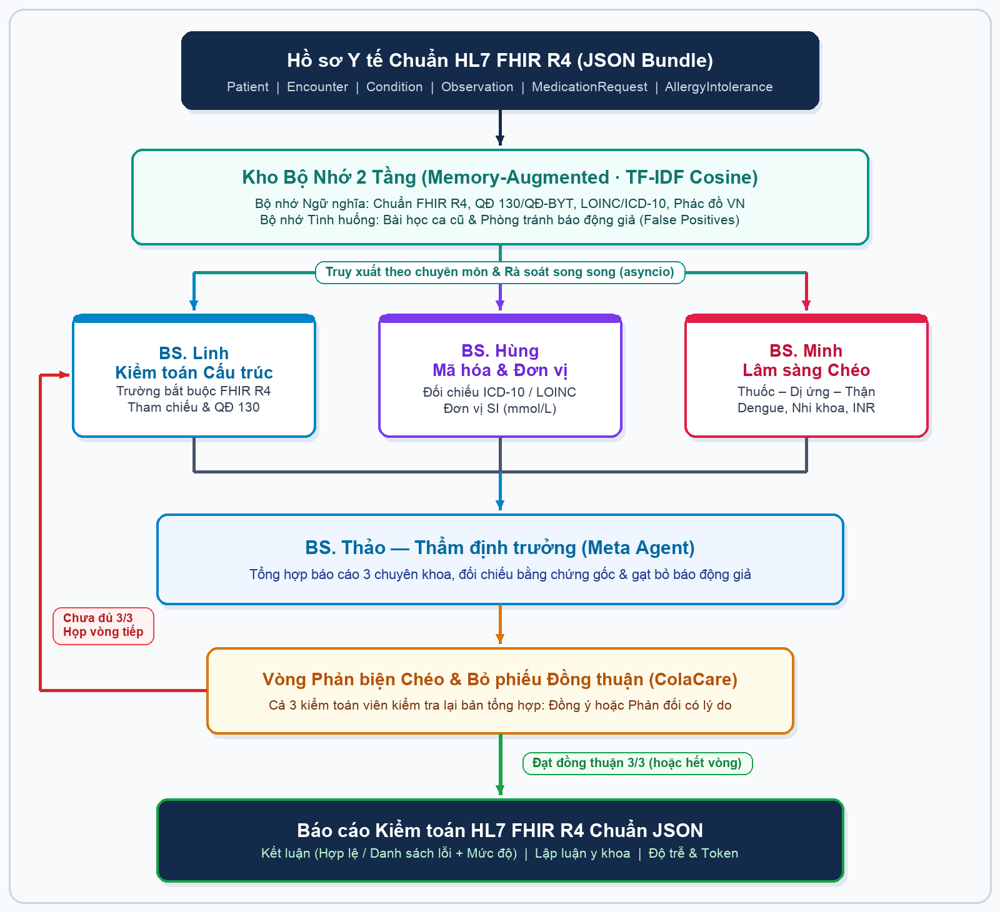

# Hệ thống Multi-Agent dựa trên LLM và Memory-Augmented trong Rà soát Dữ liệu Y tế chuẩn HL7 FHIR R4

Dự án nghiên cứu và thực nghiệm đánh giá hiệu năng của hệ thống **Đa tác nhân (Multi-Agent)** kết hợp **Tăng cường Bộ nhớ 2 tầng (Memory-Augmented)** cho bài toán rà soát chất lượng và an toàn lâm sàng trên dữ liệu y tế chuẩn **HL7 FHIR R4** (bao gồm chuẩn quốc tế và bản địa hóa Việt Nam theo Quyết định 130/QĐ-BYT, đơn vị đo SI `mmol/L`, phác đồ Bộ Y tế).

Dự án kế thừa khung kiến trúc hội chẩn đa chuyên khoa **ColaCare** và phương pháp đánh giá thực nghiệm từ bài báo gốc **MedAgentBoard** (*NeurIPS 2025 Datasets & Benchmarks Track*, [arXiv:2505.12371](https://arxiv.org/abs/2505.12371)).

---

## 1. Tổng quan nghiệp vụ và kiến trúc

### 1.1. Bài toán giải quyết
Một hồ sơ bệnh án điện tử chuẩn **HL7 FHIR R4** (dạng JSON Bundle) gồm nhiều tài nguyên liên kết nhau (`Patient`, `Encounter`, `Condition`, `Observation`, `MedicationRequest`, `AllergyIntolerance`). Quá trình rà soát cần phát hiện 3 nhóm lỗi chính:
1. **Lỗi cấu trúc (`STRUCTURAL`):** Thiếu trường bắt buộc FHIR R4, gãy liên kết tham chiếu (`reference`), ngày khám/ngày sinh phi lý, sai quy cách mã định danh CCCD (12 số) và thẻ BHYT (10 hoặc 15 ký tự) theo QĐ 130/QĐ-BYT.
2. **Lỗi mã hóa và đơn vị (`TERMINOLOGY`):** Sai lệch giữa mã ICD-10 / LOINC và mô tả bệnh/xét nghiệm (bao gồm viết tắt lâm sàng tiếng Việt như `THA`, `ĐTĐ`), nhầm đơn vị đo UCUM/SI (`mmol/L` so với `mg/dL`), hoặc giá trị sinh tồn bất khả thi (`SpO2 > 100%`, huyết áp tâm thu nhỏ hơn tâm trương).
3. **Lỗi ngữ nghĩa lâm sàng chéo (`CLINICAL_SEMANTIC`):** Từng phiếu đúng cú pháp nhưng mâu thuẫn khi đối chiếu chéo nhiều phiếu — ví dụ: dị ứng nặng Penicillin vẫn kê Amoxicillin; suy thận nặng `eGFR < 30` vẫn kê Metformin; bệnh nhân nam có chẩn đoán sản khoa; trẻ 4 tuổi mắc cúm kê Aspirin; sốt xuất huyết Dengue giảm tiểu cầu kê Ibuprofen (NSAID).

Các trình kiểm tra luật cứng truyền thống (`Rule-based Validator`) bắt tốt lỗi cấu trúc nhưng bỏ lọt hoàn toàn nhóm lỗi ngữ nghĩa lâm sàng chéo. Ngược lại, dùng một LLM đơn lẻ dễ sót chi tiết và phát sinh báo động giả (*False Positives*).

### 1.2. Kiến trúc Hội đồng 4 Tác nhân + Kho Bộ Nhớ 2 tầng



- **Kho Bộ Nhớ 2 tầng (`fhir_audit/memory.py`)** truy xuất theo thuật toán TF-IDF Cosine Similarity (NumPy thuần):
  - **Bộ nhớ Ngữ nghĩa (Semantic Memory):** Lưu quy chuẩn HL7 FHIR R4, quy định QĐ 130/QĐ-BYT, bảng mã LOINC/ICD-10, đơn vị SI Việt Nam và quy tắc chống chỉ định lâm sàng.
  - **Bộ nhớ Tình huống (Episodic Memory):** Lưu các mẫu lỗi đã xác nhận và các tình huống dễ gây báo động giả (ví dụ: đường huyết `7.8 mmol/L` chuẩn Việt Nam hay sốt xuất huyết Dengue dùng Paracetamol là hợp lệ).
- **Hội đồng 4 Tác nhân chạy bất đồng bộ (`asyncio`):**
  1. **BS. Linh (Kiểm toán Cấu trúc FHIR):** Kiểm tra trường bắt buộc, tham chiếu, mốc thời gian và định danh CCCD/BHYT.
  2. **BS. Hùng (Kiểm toán Mã hóa & Chỉ số):** Đối chiếu mã ICD-10/LOINC, đơn vị UCUM/SI và ngưỡng sinh lý.
  3. **BS. Minh (Kiểm toán Lâm sàng Chéo):** Phát hiện xung đột Thuốc – Dị ứng – Xét nghiệm – Chẩn đoán.
  4. **BS. Thảo (Thẩm định trưởng — Meta Agent):** Tổng hợp báo cáo, kiểm chứng bằng chứng gốc để lọc báo động giả và chủ trì vòng phản biện đồng thuận (tối đa 2–3 vòng theo cơ chế ColaCare).

---

## 2. Cấu trúc thư mục dự án

```text
MedAgentBoard/
├── fhir_audit/                    # Lõi thực nghiệm rà soát HL7 FHIR R4 (Đóng góp chính)
│   ├── dataset_generator.py       # Sinh bộ 32 hồ sơ FHIR R4 có nhãn chuẩn (Quốc tế + VN-FHIR)
│   ├── synthea_importer.py        # Nạp 100-200 hồ sơ từ Synthea FHIR R4 và bơm lỗi tự động
│   ├── memory.py                  # Kho Bộ nhớ 2 tầng (Semantic + Episodic, TF-IDF Cosine)
│   ├── rule_validator.py          # Đối chứng 1: Bộ kiểm tra luật xác định (0 token)
│   ├── rate_limiter.py            # Bộ điều phối tốc độ gọi API (chống 429/503, đo latency chuẩn)
│   ├── agents.py                  # Cài đặt 6 cấu hình thực nghiệm (Single-LLM, Multi-Agent, Ablation)
│   ├── run_benchmark.py           # Chạy thực nghiệm hàng loạt (có cache tự lưu từng ca)
│   ├── evaluate.py                # Tính Accuracy, Precision, Recall, F1, FPR & Bootstrap 1.000 lần
│   ├── plot_charts.py             # Tự động vẽ 3 biểu đồ PNG 300 DPI + SVG nền trắng
│   └── plot_architecture.py       # Vẽ sơ đồ kiến trúc 4 tác nhân đưa vào slide/báo cáo
├── pixel_mdt/                     # Giao diện trực quan hóa Phòng Hội Chẩn 2D nền sáng
│   ├── server.py                  # Máy chủ Starlette + Server-Sent Events (SSE)
│   ├── engine.py                  # Engine ColaCare cho tác vụ MedQA gốc
│   └── static/                    # Giao diện nền sáng thuần Việt (index.html, style.css, pixel_room.js, app.js)
├── medagentboard/                 # Mã nguồn gốc từ bài báo MedAgentBoard (MedQA, EHR, LaySummary)
│   └── utils/llm_configs.py       # Cấu hình tập trung các nhà cung cấp LLM (Gemini, DeepSeek, Qwen)
├── docs/                          # Tài liệu báo cáo và hình vẽ cho slide
│   ├── KHUNG_BAO_CAO_PPNCKH.md    # Khung báo cáo 5 chương, giải thích mã nguồn và Q&A hội đồng
│   └── hinh_9_1_luong_4_agent.png # Sơ đồ luồng 4 tác nhân 300 DPI
├── my_datasets/processed/         # Tập dữ liệu benchmark đã sinh (fhir_benchmark.json, PubMedQA)
├── logs/fhir_audit/results/       # Kết quả thực nghiệm (.json, .csv, .md) và thư mục charts/
├── pyproject.toml                 # Khai báo phiên bản Python và thư viện phụ thuộc
└── .env.example                   # Mẫu tệp cấu hình khóa API
```

---

## 3. Hướng dẫn cài đặt từ đầu

### Yêu cầu hệ thống
- **Python 3.12** trở lên.
- Trình quản lý gói **[uv](https://github.com/astral-sh/uv)** (khuyến nghị) hoặc `pip` tiêu chuẩn.

### Bước 1: Cài đặt thư viện

**Cách 1 — Dùng `uv` (nhanh nhất, tự tạo `.venv`):**
```bash
uv sync
```

**Cách 2 — Dùng `pip` truyền thống (nếu máy chưa cài `uv`):**
```bash
python3 -m venv .venv
source .venv/bin/activate          # Trên Windows PowerShell: .venv\Scripts\Activate.ps1
pip install openai pandas numpy python-dotenv starlette uvicorn httpx pillow streamlit
```

### Bước 2: Cấu hình tệp `.env`
Sao chép tệp mẫu và điền khóa API của bạn (chỉ cần 1 khóa `GEMINI_API_KEY` từ Google AI Studio là chạy được đầy đủ):
```bash
cp .env.example .env
```
Mở tệp `.env` và điền khóa:
```env
GEMINI_API_KEY=AIzaSy...
# Tùy chọn giới hạn số request/phút cho Gemini Free Tier (mặc định: 12)
GEMINI_MAX_RPM=12
```
> **Lưu ý:** Nếu chưa có khóa API, bạn vẫn có thể khởi chạy giao diện web và trải nghiệm ngay chế độ **Mô phỏng 2 vòng FHIR + Bộ nhớ (0đ)** cũng như chạy **Đối chứng 1: Bộ kiểm tra Luật FHIR (`rule_based`)** hoàn toàn miễn phí.

---

## 4. Hướng dẫn chạy hệ thống

### 4.1. Khởi chạy Giao diện Phòng Hội Chẩn 2D nền sáng (Web UI)
Chạy lệnh sau tại thư mục gốc dự án:
```bash
.venv/bin/python -m pixel_mdt.server
```
Mở trình duyệt tại địa chỉ: **http://127.0.0.1:8050**

**Các tính năng chính trên giao diện:**
- **Chọn hồ sơ mẫu:** Gồm 32 hồ sơ HL7 FHIR R4 chuẩn quốc tế và Việt Nam (hoặc chỉnh sửa/dán trực tiếp JSON FHIR mới).
- **Chọn cấu hình chạy:** Chuyển đổi nhanh giữa *Mô phỏng 2 vòng (0đ)*, *Multi-Agent + Bộ nhớ 2 tầng (Đề xuất)*, các cấu hình *Đối chứng*, và *Bộ kiểm tra luật FHIR*.
- **Tương tác trực tiếp:** Nhấn chuột vào từng bác sĩ hoặc vào **Kho bộ nhớ** trên phòng họp 2D để xem chính xác quy chuẩn Semantic/Episodic đã truy xuất, câu lệnh hệ thống (System Prompt), JSON đầu ra, độ trễ và lượng Token.
- **Tab Thực nghiệm & Phát lại:** Xem bảng tổng hợp kết quả benchmark ngay trên web và phát lại (Replay) các phiên hội chẩn đã lưu mà không tốn thêm API.

### 4.2. Chạy thực nghiệm đánh giá hiệu năng (Benchmark CLI)

**Bước 1 — Sinh lại bộ dữ liệu 32 hồ sơ FHIR R4 (nếu cần):**
```bash
.venv/bin/python -m fhir_audit.dataset_generator
```

**Bước 2 — Chạy thực nghiệm so sánh các phương pháp:**
```bash
.venv/bin/python -m fhir_audit.run_benchmark \
  --model gemini-3.5-flash-lite \
  --per_category 4 \
  --methods rule_based single_llm single_llm_memory multi_agent_no_mem multi_agent_memory
```

**Các tham số tùy chọn quan trọng:**
- `--per_category 4`: Chạy 4 hồ sơ mỗi nhóm (tổng 16 hồ sơ cân bằng). Bỏ cờ này (hoặc đặt `0`) để chạy toàn bộ **32 hồ sơ**.
- `--methods ...`: Chọn từ 6 cấu hình:
  - `rule_based`: Đối chứng 1 — Bộ kiểm tra luật xác định (0 token).
  - `single_llm`: Đối chứng 2 — 1 LLM rà soát trực tiếp (Zero-shot).
  - `single_llm_memory`: Đối chứng 3 — 1 LLM + Bộ nhớ 2 tầng (RAG).
  - `multi_agent_no_mem`: Đối chứng 4 — Hội đồng Multi-Agent ColaCare không Bộ nhớ.
  - `multi_agent_sem`: Ablation — Hội đồng Multi-Agent + chỉ Bộ nhớ Ngữ nghĩa.
  - `multi_agent_memory`: Hệ thống đề xuất — Hội đồng Multi-Agent + Bộ nhớ 2 tầng.
- `--force`: Bỏ qua cache cũ và chạy lại toàn bộ (mặc định script tự lưu cache từng ca để có thể dừng và chạy tiếp không mất dữ liệu).

**Kết quả tự động xuất ra tại `logs/fhir_audit/results/`:**
- `benchmark_report.md`: Bảng kết quả Markdown kèm Bootstrap 1.000 lần (sẵn sàng chép vào báo cáo).
- `benchmark_summary.csv`: Tệp bảng tính mở bằng Excel.
- `benchmark_summary.json`: Dữ liệu nạp trực tiếp cho Tab *Thực nghiệm* trên Web UI.
- `charts/`: Tự động sinh 3 biểu đồ chuẩn báo cáo (**PNG 300 DPI** và **SVG vector**):
  1. `chart1_f1_fpr_comparison.png` — So sánh F1-score (có thanh sai số Bootstrap `±Std`) và tỷ lệ báo động giả (FPR).
  2. `chart2_category_recall.png` — So sánh Recall tách riêng 3 nhóm lỗi (*Cấu trúc*, *Mã hóa*, *Lâm sàng chéo*).
  3. `chart3_efficiency_tradeoff.png` — Phân tích đánh đổi giữa F1-score, Độ trễ (giây/hồ sơ) và Chi phí Token.

Để vẽ lại 3 biểu đồ từ file JSON sẵn có mà không gọi lại LLM:
```bash
.venv/bin/python -m fhir_audit.plot_charts
```

### 4.3. Mở rộng tập dữ liệu quy mô lớn với Synthea (Tùy chọn)
Nếu bạn tải bộ sinh dữ liệu y tế chuẩn quốc tế [Synthea](https://github.com/synthetichealth/synthea) và tạo sẵn thư mục `output/fhir/`, chạy lệnh sau để nhập và bơm lỗi có kiểm soát cho 100 hồ sơ:
```bash
.venv/bin/python -m fhir_audit.synthea_importer \
  --synthea_dir /duong/dan/toi/synthea/output/fhir \
  --num_cases 100 \
  --output my_datasets/processed/fhir_audit/synthea_benchmark_100.json
```

---

## 5. Xử lý các lỗi thường gặp (Troubleshooting)

- **Lỗi `429 RESOURCE_EXHAUSTED` (Hết giới hạn request/phút trên Gemini Free Tier):**
  Hệ thống đã tích hợp sẵn bộ điều phối `fhir_audit/rate_limiter.py` tự giới hạn ở mức 12 RPM và tự chờ theo `retryDelay` của máy chủ. Nếu dùng gói trả phí có quota cao hơn, thêm `GEMINI_MAX_RPM=60` vào `.env`.
- **Lỗi `503 UNAVAILABLE` (Máy chủ model quá tải tạm thời):**
  Bộ `rate_limiter.py` sẽ tự động giãn nhịp thử lại tối đa 5 lần. Nếu một ca vẫn lỗi, cứ để chạy xong rồi chạy lại đúng lệnh benchmark — các ca đã xong sẽ đọc từ cache trong 0.1 giây và chỉ chạy bù những ca bị thiếu.
- **Lỗi `404 NOT_FOUND` (Tên model cũ không còn mở cho tài khoản mới):**
  Kiểm tra danh sách model đang được hỗ trợ trong `medagentboard/utils/llm_configs.py` (mặc định khuyên dùng `gemini-3.5-flash-lite` hoặc `gemini-2.5-flash`).
- **Lỗi `zsh: unknown file attribute` trên macOS:**
  Khi copy lệnh dán vào terminal `zsh`, không copy các dòng chú thích bắt đầu bằng dấu `#`.

---

## 6. Tài liệu kèm theo và Trích dẫn

- Tài liệu khung báo cáo 5 chương, giải thích chi tiết từng tệp mã nguồn và bộ câu hỏi phản biện hội đồng: [`docs/KHUNG_BAO_CAO_PPNCKH.md`](docs/KHUNG_BAO_CAO_PPNCKH.md).
- Bài báo gốc mà dự án này kế thừa khung benchmark và kiến trúc ColaCare:

```bibtex
@article{zhu2025medagentboard,
  title={{MedAgentBoard}: Benchmarking Multi-Agent Collaboration with Conventional Methods for Diverse Medical Tasks},
  author={Zhu, Yinghao and He, Ziyi and Hu, Haoran and Zheng, Xiaochen and Zhang, Xichen and Wang, Zixiang and Gao, Junyi and Ma, Liantao and Yu, Lequan},
  journal={arXiv preprint arXiv:2505.12371},
  year={2025}
}
```

*Lưu ý y khoa: Đây là hệ thống phục vụ mục đích nghiên cứu học thuật và hỗ trợ tham khảo kiểm toán chất lượng dữ liệu y tế, không thay thế quyết định chuyên môn của bác sĩ lâm sàng.*
