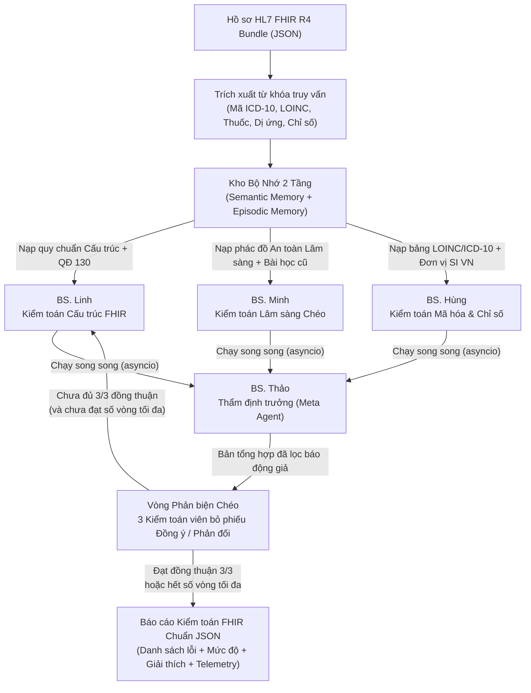

# KHUNG BÁO CÁO CHI TIẾT & HƯỚNG DẪN HIỂU TOÀN BỘ ĐỀ TÀI PPNCKH

> **Tên đề tài:** *Nghiên cứu và đánh giá hiệu năng hệ thống Multi-Agent dựa trên LLM và Memory-Augmented trong rà soát dữ liệu y tế chuẩn FHIR*  
> **Bài báo nền tảng kế thừa:** *MedAgentBoard: Benchmarking Multi-Agent Collaboration with Conventional Methods for Diverse Medical Tasks* (NeurIPS 2025 Datasets & Benchmarks Track)

---

## PHẦN 0: HIỂU ĐỀ TÀI TRONG 3 PHÚT (Dành cho người mới / không rành kỹ thuật)

### 1. Bảng "dịch" các thuật ngữ kỹ thuật sang ngôn ngữ đời thường

| Thuật ngữ trong đề tài | Dịch sang đời thường (ví dụ bệnh viện) | Trong code nằm ở đâu? |
| :--- | :--- | :--- |
| **HL7 FHIR R4** | Bộ "mẫu bệnh án điện tử quốc tế" dạng tệp dữ liệu JSON, chia bệnh án thành từng phiếu rời nhưng móc nối với nhau: Phiếu Hành chính (`Patient`), Phiếu Khám (`Encounter`), Phiếu Chẩn đoán (`Condition`), Phiếu Xét nghiệm (`Observation`), Đơn thuốc (`MedicationRequest`), Phiếu Dị ứng (`AllergyIntolerance`). | `fhir_audit/dataset_generator.py` |
| **Rà soát dữ liệu y tế (Clinical Data Auditing)** | Công việc của tổ kiểm tra chất lượng hồ sơ bệnh án / giám định BHYT trước khi lưu trữ hoặc thanh toán: phát hiện xem hồ sơ có bị thiếu thông tin, ghi nhầm đơn vị, hay bác sĩ kê thuốc nguy hiểm mâu thuẫn với xét nghiệm/dị ứng không. | `fhir_audit/agents.py` |
| **LLM (Mô hình ngôn ngữ lớn)** | Một "trợ lý trí tuệ nhân tạo" đã đọc hàng triệu sách vở và tài liệu y khoa (như Gemini, DeepSeek, Qwen). Ta không cần dạy lại từ đầu (không train lại), chỉ cần giao đúng vai và đưa hồ sơ cho nó đọc. | `medagentboard/utils/llm_configs.py` |
| **Multi-Agent (Hệ thống đa tác nhân)** | Thay vì hỏi **1 con AI** trả lời một phát xong luôn (dễ bỏ sót hoặc tự tin đoán bừa), ta tạo ra một **Hội đồng 4 chuyên gia AI** ngồi chung phòng: mỗi người soi 1 mảng riêng, rồi tranh luận/phản biện chéo nhau trước khi chốt. | `fhir_audit/agents.py` |
| **Memory-Augmented (Tăng cường bộ nhớ)** | Gắn thêm một **"Tủ tài liệu tham khảo + Sổ tay kinh nghiệm"** cho các chuyên gia AI tra cứu trước khi làm việc, thay vì bắt AI nhớ chay trong đầu. | `fhir_audit/memory.py` |
| **Semantic Memory (Bộ nhớ ngữ nghĩa)** | **"Tủ sách quy chuẩn"** chứa luật chuẩn FHIR R4, quy định CCCD/BHYT của Việt Nam (QĐ 130/QĐ-BYT), bảng mã bệnh ICD-10, đơn vị đo `mmol/L`, phác đồ chống chỉ định thuốc. | `SEMANTIC_GUIDELINES` trong `fhir_audit/memory.py` |
| **Episodic Memory (Bộ nhớ tình huống)** | **"Sổ tay ghi chép các ca rà soát cũ"**, đặc biệt ghi lại những *cái bẫy* mà trước đây AI từng bắt nhầm (ví dụ: bệnh nhân dị ứng Penicillin nhưng kê Azithromycin là hoàn toàn an toàn, không được báo lỗi nhầm). | `DEFAULT_EPISODIC_LESSONS` trong `fhir_audit/memory.py` |
| **False Positive (Báo động giả)** | Hồ sơ bệnh án hoàn toàn sạch, đúng chuẩn, nhưng AI lại "nhìn gà hóa cuốc" báo là có lỗi. Trong bệnh viện, báo động giả nhiều sẽ làm bác sĩ chán nản và bỏ qua cảnh báo thật. | `fhir_audit/evaluate.py` (`FPR`) |
| **Ablation Study (Thí nghiệm loại trừ)** | Tháo lần lượt từng bộ phận ra xem hiệu quả tụt bao nhiêu (ví dụ: tắt Bộ nhớ, tắt Hội đồng nhiều Agent) để chứng minh **mỗi thành phần mình thêm vào đều thực sự có ích**. | `fhir_audit/run_benchmark.py` |
| **Bootstrap 1.000 lần** | Phương pháp thống kê bốc mẫu lặp lại 1.000 lần để tính độ dao động (`Mean ± Std`), chứng minh kết quả đo được là ổn định chứ không phải do ăn may. | `_bootstrap_f1()` trong `fhir_audit/evaluate.py` |

### 2. Câu chuyện cốt lõi của đề tài (Để mở đầu bài thuyết trình)

Trong bệnh viện hiện đại, hồ sơ bệnh nhân được số hóa thành dữ liệu chuẩn **HL7 FHIR**. Có 3 loại lỗi có thể xảy ra trong một hồ sơ bệnh án:
1. **Lỗi cấu trúc (Structural):** Thiếu giới tính bệnh nhân, ngày ra viện ghi sớm hơn ngày nhập viện, mã thẻ BHYT thiếu số, phiếu xét nghiệm gắn nhầm mã bệnh nhân khác.
2. **Lỗi mã hóa & đơn vị (Terminology):** Ghi tên bệnh là "Tăng huyết áp (THA)" nhưng chọn nhầm mã ICD-10 của "Tiểu đường (E11.9)"; hoặc bệnh viện Việt Nam hay dùng `mmol/L` nhưng nhân viên nhập nhầm đường huyết `185 mmol/L` (thay vì `185 mg/dL`).
3. **Lỗi ngữ nghĩa lâm sàng chéo (Clinical Semantic — NGUY HIỂM NHẤT):** Từng phiếu nhìn riêng đều **đúng 100% cú pháp**, nhưng ghép lại với nhau lại mâu thuẫn chết người:
   - Phiếu Dị ứng ghi *dị ứng nặng Penicillin*, nhưng Đơn thuốc lại kê *Amoxicillin* (cùng họ Penicillin).
   - Phiếu Xét nghiệm ghi *suy thận độ 4 (eGFR = 18)*, nhưng Đơn thuốc vẫn kê *Metformin 1000 mg* (chống chỉ định tuyệt đối vì gây nhiễm toan lactic).
   - Phiếu Chẩn đoán ghi *Sốt xuất huyết Dengue giảm tiểu cầu (A97.1)*, nhưng Đơn thuốc lại kê *Ibuprofen (NSAID)* gây nguy cơ xuất huyết nặng.

**Vấn đề đặt ra:**
- Các **phần mềm kiểm tra luật cứng truyền thống (Rule-based Validator)** chạy siêu nhanh (1 mili-giây, miễn phí), bắt đúng 100% lỗi cấu trúc, nhưng **bỏ lọt 100% lỗi ngữ nghĩa lâm sàng chéo** (`Recall = 0%`).
- Nếu dùng **1 con AI (Single-LLM)** đọc thẳng hồ sơ: nó thông minh hơn luật cứng nhưng hay **quên chi tiết khi hồ sơ dài**, không rành quy định đặc thù Việt Nam (`mmol/L`, QĐ 130/QĐ-BYT) và hay **báo động giả** trên hồ sơ sạch.
- **Giải pháp của đề tài:** Kế thừa kiến trúc hội chẩn đa tác nhân **ColaCare** từ bài báo *MedAgentBoard* (NeurIPS 2025) và nâng cấp thêm **Bộ nhớ 2 tầng (Memory-Augmented)** để 3 kiểm toán viên chuyên biệt + 1 thẩm định trưởng cùng rà soát song song, tra cứu đúng quy chuẩn, rồi phản biện chéo nhau để chốt báo cáo chính xác nhất.

---

## PHẦN 1: KHUNG BÁO CÁO CHI TIẾT 5 CHƯƠNG (Dùng viết Word / LaTeX)

### CHƯƠNG 1. MỞ ĐẦU

#### 1.1. Đặt vấn đề & Bối cảnh thực tiễn
- Xu hướng chuyển đổi số y tế toàn cầu và tại Việt Nam (Thông tư 46/2018/TT-BYT về hồ sơ bệnh án điện tử EMR, Thông tư 54/2017/TT-BYT, Quyết định 130/QĐ-BYT về chuẩn dữ liệu giám định BHYT, lộ trình liên thông theo chuẩn **HL7 FHIR**).
- Thực trạng sai sót dữ liệu y tế khi liên thông đa hệ thống (HIS/LIS/PACS): lỗi cấu trúc, lệch mã hóa ICD-10/LOINC, nhầm đơn vị SI (`mmol/L` ↔ `mg/dL`), và đặc biệt là sai sót an toàn lâm sàng chéo giữa các tài nguyên dữ liệu.
- Hạn chế của các trình kiểm duyệt chuẩn FHIR truyền thống (như HAPI FHIR Validator): chỉ kiểm tra cú pháp/schema xác định, không có khả năng suy luận ngữ nghĩa lâm sàng.

#### 1.2. Kế thừa bài báo gốc & Khoảng trống nghiên cứu (Research Gaps)
- Giới thiệu bài báo nền **MedAgentBoard** (Zhu et al., NeurIPS 2025): benchmark hệ thống đầu tiên so sánh công bằng giữa *Conventional Methods*, *Single-LLM*, và *Multi-Agent Collaboration* (ColaCare, ReConcile, MDAgents, MedAgents...) trên 4 tác vụ y khoa.
- Chỉ ra **2 khoảng trống nghiên cứu** mà bài báo gốc chưa giải quyết và đề tài này tập trung giải quyết:
  1. **Khoảng trống về tác vụ & chuẩn dữ liệu:** MedAgentBoard mới xét bài toán hỏi đáp (MedQA), tóm tắt (Lay Summary) và EHR bảng phẳng, chưa nghiên cứu bài toán **rà soát dữ liệu phân cấp đa tài nguyên chuẩn HL7 FHIR R4** (và bản địa hóa quy chuẩn Việt Nam).
  2. **Khoảng trống về cơ chế bộ nhớ (Memory):** Các tác nhân trong MedAgentBoard chỉ có `self.memory = []` dạng bộ nhớ tạm trong 1 phiên chạy — kết thúc mỗi hồ sơ là mất trắng. Chưa có cơ chế **Memory-Augmented dài hạn** (Semantic + Episodic) để tra cứu quy chuẩn và học kinh nghiệm tránh báo động giả.

#### 1.3. Mục tiêu và Câu hỏi nghiên cứu (Research Questions)
- **RQ1 (Hiệu quả phát hiện lỗi):** Hệ thống Multi-Agent kết hợp Memory-Augmented có cải thiện đáng kể F1-score và khả năng phát hiện lỗi ngữ nghĩa lâm sàng chéo so với bộ kiểm tra luật truyền thống và Single-LLM hay không?
- **RQ2 (Tác động của Memory-Augmented — Ablation):** Việc bổ sung Bộ nhớ Ngữ nghĩa (Semantic) và Bộ nhớ Tình huống (Episodic) đóng góp cụ thể như thế nào vào việc tăng Recall trên ca đặc thù Việt Nam và giảm tỷ lệ báo động giả (FPR)?
- **RQ3 (Đánh đổi hiệu năng — Effectiveness vs. Efficiency):** Chi phí đánh đổi về độ trễ (Latency) và lượng Token tiêu thụ giữa các phương pháp là bao nhiêu, và tối ưu thực thi song song (`asyncio`) giúp cải thiện hiệu năng như thế nào?

#### 1.4. Phạm vi và Đóng góp chính của đề tài
1. Xây dựng tập benchmark **32 hồ sơ HL7 FHIR R4 có nhãn chuẩn** (cân bằng 4 nhóm: Hợp lệ, Cấu trúc, Mã hóa, Lâm sàng chéo), tích hợp đặc thù y tế Việt Nam (QĐ 130/QĐ-BYT, đơn vị `mmol/L`, SXH Dengue) kèm công cụ mở rộng quy mô lớn từ **Synthea**.
2. Thiết kế & cài đặt kiến trúc **Memory-Augmented Multi-Agent FHIR Auditor** (kế thừa cơ chế đồng thuận ColaCare + Kho bộ nhớ 2 tầng Semantic/Episodic + thực thi bất đồng bộ + Rate Limiter chống lỗi 429).
3. Thực hiện đánh giá hiệu năng toàn diện trên 6 cấu hình đối chứng/Ablation với thống kê Bootstrap 1.000 lần và xây dựng giao diện trực quan hóa quy trình hội chẩn 2D nền sáng.

---

### CHƯƠNG 2. CƠ SỞ LÝ THUYẾT

#### 2.1. Chuẩn dữ liệu y tế HL7 FHIR R4 và hồ sơ Việt Nam
- Giải thích cấu trúc dạng **Bundle** gồm nhiều **Resource** liên kết qua trường `reference` (ví dụ `Observation.subject.reference = "Patient/pat-402"`).
- Trình bày 6 Resource cốt lõi dùng trong đề tài: `Patient`, `Encounter`, `Condition` (ICD-10), `Observation` (LOINC + UCUM), `MedicationRequest` (RxNorm/hoạt chất), `AllergyIntolerance`.
- Các đặc thù cần bản địa hóa tại Việt Nam: định danh CCCD 12 số / BHYT 10–15 ký tự (QĐ 130/QĐ-BYT), đơn vị đo SI (`mmol/L`), từ viết tắt lâm sàng tiếng Việt (`THA`, `ĐTĐ`, `STM`), phác đồ Bộ Y tế (Sốt xuất huyết Dengue chống chỉ định NSAID).

#### 2.2. Mô hình ngôn ngữ lớn (LLM) và Hệ thống đa tác nhân (Multi-Agent)
- Khái niệm LLM hoạt động theo cơ chế *Zero-shot / Structured JSON Output*.
- Nguyên lý phối hợp đa chuyên khoa **ColaCare** (từ *MedAgentBoard*): chia vai chuyên môn độc lập → tổng hợp bởi tác nhân điều phối (Meta Agent) → vòng phản biện đồng thuận (`agree/disagree`) nhằm hạn chế ảo giác (hallucination) của 1 mô hình đơn lẻ.

#### 2.3. Kiến trúc tăng cường bộ nhớ (Memory-Augmented Agents)
- Phân biệt rõ **3 tầng bộ nhớ** trong hệ thống đề xuất:
  1. **Working Memory (Ngắn hạn):** Lưu lịch sử phát biểu, tổng hợp và phản biện qua các vòng 1, 2, 3 trong cùng một phiên rà soát.
  2. **Semantic Memory (Tri thức chuẩn — RAG):** Lưu các quy tắc FHIR R4, ánh xạ LOINC/ICD-10, phác đồ an toàn lâm sàng.
  3. **Episodic Memory (Kinh nghiệm tình huống):** Lưu các mẫu lỗi từng phát hiện và các *"bẫy báo động giả"* (những ca sạch nhưng dễ bị AI bắt nhầm).
- **Cơ chế truy xuất minh bạch (TF-IDF + Cosine Similarity):**
  - Mỗi tài liệu trong kho bộ nhớ và chuỗi tóm tắt hồ sơ FHIR được biểu diễn thành vector trọng số TF-IDF:
    $$w_{t,d} = \left(1 + \ln(\text{tf}_{t,d})\right) \times \left(\ln\frac{N + 1}{\text{df}_t + 1} + 1\right)$$
  - Độ tương đồng giữa hồ sơ cần rà soát ($\mathbf{q}$) và mỗi mục bộ nhớ ($\mathbf{d}$) tính bằng tích vô hướng chuẩn hóa (Cosine Similarity):
    $$\text{sim}(\mathbf{q}, \mathbf{d}) = \frac{\mathbf{q} \cdot \mathbf{d}}{\|\mathbf{q}\| \, \|\mathbf{d}\|}$$
  - *Lý do chọn phương pháp này (giải thích rất thuyết phục trước hội đồng):* Nhẹ, chạy hoàn toàn bằng NumPy trong vài mili-giây, không cần GPU, khớp chính xác tuyệt đối với các mã chuẩn y khoa như `4548-4`, `E11.9`, `A97.1`, `eGFR` (vốn hay bị model embedding tổng quát làm nhòe ngữ nghĩa) và dễ truy vết minh bạch trong báo cáo.

---

### CHƯƠNG 3. KIẾN TRÚC HỆ THỐNG VÀ QUY TRÌNH NGHIỆP VỤ ĐỀ XUẤT

#### 3.1. Sơ đồ luồng nghiệp vụ tổng thể

#### 3.2. Phân vai chi tiết của 4 tác nhân (Agents)
1. **BS. Linh — Kiểm toán Cấu trúc FHIR (`STRUCTURAL`):** Chuyên kiểm tra đủ trường bắt buộc FHIR R4, không gãy liên kết tham chiếu (`reference`), tính hợp lệ thời gian (`birthDate`, `Encounter.period`) và định dạng CCCD/BHYT theo QĐ 130/QĐ-BYT.
2. **BS. Minh — Kiểm toán Lâm sàng Chéo (`CLINICAL_SEMANTIC`):** Chuyên đối chiếu chéo nhiều phiếu để phát hiện xung đột thuốc–dị ứng, thuốc–chức năng thận (`eGFR`), giới tính–chẩn đoán, tuổi nhi–thuốc, xét nghiệm nguy kịch–y lệnh và chống chỉ định SXH Dengue / Hen phế quản.
3. **BS. Hùng — Kiểm toán Mã hóa & Chỉ số (`TERMINOLOGY`):** Chuyên đối chiếu mã ICD-10 / LOINC có khớp mô tả (gồm viết tắt tiếng Việt `THA`, `ĐTĐ`) không, kiểm tra đơn vị UCUM/SI (`mmol/L` vs `mg/dL`) và ngưỡng sinh lý hợp lý (`SpO2 <= 100%`, `SBP > DBP`).
4. **BS. Thảo — Thẩm định trưởng (`Meta Adjudicator`):** Không thiên vị chuyên khoa nào; nhận báo cáo từ 3 người, loại bỏ trùng lặp, kiểm tra lại bằng chứng trên hồ sơ gốc để **cắt bỏ báo động giả**, sau đó gửi lại để cả 3 người xác nhận đồng thuận.

#### 3.3. Thiết kế kỹ thuật đảm bảo vận hành thực tế (Production Readiness)
- **Thực thi song song (`asyncio.as_completed`):** Cả 3 kiểm toán viên chạy đồng thời ở pha Phân tích và pha Phản biện, giảm đáng kể độ trễ tổng so với chạy tuần tự trong code gốc của MedAgentBoard.
- **Chuẩn hóa đầu ra JSON & Fallback Parsing:** Ép LLM trả JSON chuẩn (`response_format={"type": "json_object"}`), đồng thời có lớp chuẩn hóa mã lỗi và parser dự phòng chống vỡ định dạng.
- **Sliding-Window Rate Limiter & Smart 429 Retry (`rate_limiter.py`):** Điều tiết lưu lượng request theo cửa sổ trượt (mặc định 12 RPM an toàn cho Gemini Free Tier) và tự động đọc thời gian `retryDelay` khi gặp lỗi 429; tách riêng thời gian chờ quota khỏi `latency_ms` để số liệu đo hiệu năng không bị sai lệch.
- **Trực quan hóa thời gian thực (SSE + Pixel 2D Light Theme):** Server Starlette phát luồng sự kiện (`memory_retrieve`, `agent_state`, `agent_output`, `packet_fly`, `consensus_update`) lên giao diện nền sáng chuẩn slide để người dùng và hội đồng thấy rõ từng bước suy luận & tra cứu bộ nhớ.

---

### CHƯƠNG 4. THIẾT KẾ THỰC NGHIỆM VÀ ĐÁNH GIÁ HIỆU NĂNG

#### 4.1. Tập dữ liệu thực nghiệm
- **Tập benchmark chính (32 hồ sơ FHIR R4 cân bằng — 8 hồ sơ/nhóm):**
  - 8 hồ sơ **Hợp lệ (`CLEAN`)**: gồm các ca "bẫy" thực tế (dị ứng Penicillin nhưng kê Azithromycin; CKD độ 4 nhưng dùng Insulin; Glucose `7.8 mmol/L` chuẩn VN; SXH Dengue dùng Paracetamol) để đo chuẩn tỷ lệ báo động giả.
  - 8 hồ sơ **Lỗi cấu trúc (`STRUCTURAL`)**: gồm cả lỗi sai CCCD/BHYT theo QĐ 130/QĐ-BYT.
  - 8 hồ sơ **Lỗi mã hóa & đơn vị (`TERMINOLOGY`)**: gồm cả nhầm đơn vị `185 mmol/L` và viết tắt `THA` lệch mã `E11.9`.
  - 8 hồ sơ **Lỗi ngữ nghĩa lâm sàng chéo (`CLINICAL_SEMANTIC`)**: gồm cả SXH Dengue kê Ibuprofen và Hen cấp kê Propranolol.
- **Khả năng mở rộng khách quan:** Trình bày thêm module `synthea_importer.py` cho phép nạp 100–200 hồ sơ từ bộ sinh dữ liệu chuẩn quốc tế **Synthea** và bơm lỗi ngẫu nhiên có kiểm soát (cố định `seed=42`).

#### 4.2. Các cấu hình đối chứng và Thí nghiệm loại trừ (Ablation Study)

| STT | Mã cấu hình | Mô tả | Mục đích so sánh |
| :---: | :--- | :--- | :--- |
| 1 | `rule_based` | Bộ kiểm tra luật xác định (0 token) | Đối chứng phương pháp truyền thống (Conventional) |
| 2 | `single_llm` | 1 LLM đọc trực tiếp FHIR Bundle | Đối chứng LLM đơn lẻ (Zero-Shot) |
| 3 | `single_llm_memory` | 1 LLM + Kho bộ nhớ 2 tầng | Tách riêng tác động của **Memory** trên 1 LLM |
| 4 | `multi_agent_no_mem` | Hội đồng 4 Agent ColaCare, **tắt Memory** | Tách riêng tác động của **Multi-Agent** thuần (bài báo gốc) |
| 5 | `multi_agent_sem` | Hội đồng 4 Agent + **chỉ Semantic Memory** | Ablation: đo riêng vai trò của Episodic Memory (giảm FPR) |
| 6 | `multi_agent_memory` | **Hệ thống đề xuất:** 4 Agent + Bộ nhớ 2 tầng | Kiểm chứng hiệu quả tổng hợp của toàn bộ kiến trúc |

#### 4.3. Bộ chỉ số đánh giá (Giải thích dễ hiểu)
- **Precision (Độ chính xác cảnh báo):** Trong số những hồ sơ hệ thống hô "Có lỗi!", có bao nhiêu % thực sự có lỗi? *(Precision cao = ít báo nhầm).*
- **Recall (Độ phủ phát hiện lỗi):** Trong số những hồ sơ thực sự có lỗi, hệ thống bắt được bao nhiêu %? *(Recall cao = ít bỏ lọt lỗi nguy hiểm).*
- **F1-score:** Trung bình điều hòa của Precision và Recall (cân bằng giữa "không bỏ lọt" và "không báo nhầm"), kèm **Bootstrap 1.000 lần (Mean ± Std, 95% CI)**.
- **FPR (False Positive Rate — Tỷ lệ báo động giả):** Tỷ lệ hồ sơ sạch bị AI báo oan là có lỗi *(càng thấp càng tốt, lý tưởng = 0%)*.
- **Hiệu năng hệ thống (Efficiency):** Độ trễ trung bình (`giây/hồ sơ`), Số lượng Token trung bình (`tokens/hồ sơ`), Số vòng hội chẩn trung bình (`rounds`), Số mục bộ nhớ truy xuất (`memory hits`).

#### 4.4. Trình bày kết quả thực nghiệm (Chèn bảng & 3 biểu đồ tự động)
Sau khi chạy lệnh `run_benchmark.py`, bạn chép trực tiếp 2 bảng từ `logs/fhir_audit/results/benchmark_report.md` và chèn 3 hình ảnh 300 DPI trong `logs/fhir_audit/results/charts/`:
1. **Hình 4.1 (`chart1_f1_fpr_comparison.png`):** So sánh F1-score (có thanh sai số Bootstrap) và FPR giữa các phương pháp.
2. **Hình 4.2 (`chart2_category_recall.png`):** Phân tích Recall tách riêng 3 nhóm lỗi — chỉ rõ `rule_based` đạt `100%` ở Cấu trúc nhưng `0%` ở Lâm sàng chéo, trong khi `multi_agent_memory` phủ đều cả 3 nhóm.
3. **Hình 4.3 (`chart3_efficiency_tradeoff.png`):** Biểu đồ bong bóng đánh đổi giữa F1-score, độ trễ và lượng Token — thảo luận rõ bài toán kiến trúc lai **Hybrid** thực tế (dùng `rule_based` lọc lỗi cấu trúc trước ở tầng 0, chỉ đẩy hồ sơ qua Multi-Agent + Memory để rà soát ngữ nghĩa nhằm tiết kiệm chi phí!).

#### 4.5. Phân tích định tính (Case Study & Error Analysis)
- **Ca thành công điển hình 1 (Lỗi lâm sàng VN):** *Sốt xuất huyết Dengue (A97.1) tiểu cầu 48 G/L nhưng kê Ibuprofen* — `rule_based` trả về `VALID` (bỏ lọt), còn hệ thống đề xuất truy xuất `SEM-CLIN-VN06` & `EPI-ERR-03` phát hiện chính xác lỗi mức `CRITICAL`.
- **Ca thành công điển hình 2 (Tránh báo động giả nhờ Episodic Memory):** *Đái tháo đường dùng `7.8 mmol/L` (đơn vị SI VN)* hoặc *Suy thận độ 4 dùng Insulin* — chỉ ra cách `EPI-FP-VN03` / `EPI-FP-02` giúp hội đồng không báo lỗi oan.
- **Phân tích ca sai / Hạn chế (Error Analysis):** Trích dẫn 1–2 ca mà hệ thống còn chậm hoặc phân loại chưa khớp hoàn toàn mã lỗi để thảo luận khách quan.

---

### CHƯƠNG 5. KẾT LUẬN, HẠN CHẾ VÀ HƯỚNG PHÁT TRIỂN

- **Kết luận:** Tóm tắt kết quả trả lời 3 câu hỏi nghiên cứu RQ1–RQ3; khẳng định giá trị thực tiễn của kiến trúc Multi-Agent + Memory-Augmented trong kiểm toán chất lượng dữ liệu y tế chuẩn HL7 FHIR.
- **Hạn chế của nghiên cứu (nêu thẳng thắn để tăng độ tin cậy khoa học):**
  1. Dữ liệu đánh giá chủ yếu là dữ liệu tổng hợp có kiểm soát (chưa thử nghiệm trên dữ liệu bệnh án thật tại bệnh viện do rào cản pháp lý về quyền riêng tư bệnh nhân).
  2. Kho bộ nhớ Semantic/Episodic hiện tại mang tính minh họa các nhóm bệnh lý phổ biến, cần đội ngũ dược sĩ/bác sĩ thẩm định khi mở rộng lên toàn bộ Dược thư Quốc gia.
  3. Hệ thống Multi-Agent tiêu tốn token và độ trễ cao hơn Single-LLM (nên triển khai theo mô hình phân tầng: Rule-based lọc trước → Multi-Agent rà soát ngữ nghĩa).
- **Hướng phát triển:** Tích hợp kết nối trực tiếp máy chủ HAPI FHIR & bộ chuyển đổi XML QĐ 130/QĐ-BYT → FHIR; nâng cấp tầng truy xuất bằng Hybrid BM25 + Embedding y khoa chuyên sâu (BioLord/MedCPT); thử nghiệm với các mô hình mã nguồn mở tự vận hành nội bộ bệnh viện (On-premise Qwen/DeepSeek qua vLLM) để đảm bảo tuyệt đối bảo mật dữ liệu bệnh nhân.

---

## PHẦN 2: BẢN ĐỒ GIẢI THÍCH TOÀN BỘ MÃ NGUỒN (Từng file làm nhiệm vụ gì?)

Nếu giảng viên hỏi *"Em mở code ra giải thích cho thầy xem hệ thống chạy từ đầu đến cuối như thế nào?"*, bạn chỉ cần đi đúng theo 7 tệp dưới đây:

### Nhóm A: Lõi thực nghiệm Rà soát FHIR (`fhir_audit/`)
1. **[`fhir_audit/dataset_generator.py`](../fhir_audit/dataset_generator.py) — "Kho bệnh án mẫu để chấm thi"**
   - Tạo ra 32 hồ sơ bệnh án JSON chuẩn HL7 FHIR R4 (gồm 8 ca sạch, 8 ca lỗi cấu trúc, 8 ca lỗi mã hóa, 8 ca lỗi lâm sàng chéo, có cả bệnh án đặc thù Việt Nam) kèm sẵn đáp án chuẩn `ground_truth_issues` để máy tự chấm điểm sau khi AI làm xong.
2. **[`fhir_audit/synthea_importer.py`](../fhir_audit/synthea_importer.py) — "Bộ nạp dữ liệu quy mô lớn từ Synthea"**
   - Khi muốn mở rộng từ 32 ca lên 100–200 ca khách quan, tệp này đọc các hồ sơ FHIR do phần mềm Synthea sinh ra, rút gọn các phiếu quan trọng rồi tự động bơm lỗi theo đúng 4 nhóm để tạo tập benchmark lớn.
3. **[`fhir_audit/rule_validator.py`](../fhir_audit/rule_validator.py) — "Nhân viên kiểm tra luật cứng (Đối chứng 1)"**
   - Viết bằng Python thuần (không dùng AI, chạy 1ms, 0 token). Kiểm tra xem JSON có thiếu trường bắt buộc không, có gãy tham chiếu không, CCCD có đủ 12 số không, ngày ra viện có trước ngày nhập viện không. Dùng làm mốc so sánh để thấy luật cứng bó tay trước lỗi ngữ nghĩa lâm sàng.
4. **[`fhir_audit/memory.py`](../fhir_audit/memory.py) — "Kho Bộ nhớ 2 tầng (Semantic + Episodic)"**
   - Chứa `LightweightVectorIndex` (tính TF-IDF & Cosine Similarity bằng NumPy), danh sách quy chuẩn `SEMANTIC_GUIDELINES` (FHIR R4, QĐ 130, LOINC, phác đồ Dengue/Metformin/Penicillin) và sổ tay kinh nghiệm `DEFAULT_EPISODIC_LESSONS`.
   - Hàm `retrieve(bundle, domain)` đọc hồ sơ đầu vào, lọc ra đúng 2–3 quy chuẩn và 2 bài học sát nhất cho từng bác sĩ AI.
5. **[`fhir_audit/rate_limiter.py`](../fhir_audit/rate_limiter.py) — "Bộ điều phối tốc độ gọi API chống lỗi 429"**
   - Giới hạn an toàn dưới 12 request/phút cho Gemini Free Tier bằng cửa sổ trượt (`AsyncSlidingWindowLimiter`). Nếu API vẫn báo 429, tự đọc số giây cần chờ rồi tự thử lại mà không làm hỏng số liệu đo thời gian suy luận (`latency_ms`).
6. **[`fhir_audit/agents.py`](../fhir_audit/agents.py) — "Trái tim của hệ thống Multi-Agent"**
   - Cài đặt đủ 6 cấu hình thí nghiệm (`rule_based`, `single_llm`, `single_llm_memory`, `multi_agent_no_mem`, `multi_agent_sem`, `multi_agent_memory`) + chế độ `stream_fhir_demo` (mô phỏng 0đ để trình chiếu).
   - Dùng `asyncio.as_completed` để 3 Kiểm toán viên (`BS. Linh`, `BS. Minh`, `BS. Hùng`) làm việc song song, gửi kết quả về `BS. Thảo` tổng hợp, rồi chạy vòng phản biện đồng thuận. Mọi bước đều phát ra sự kiện (`yield emit(...)`) để giao diện 2D hiển thị tức thì.
7. **[`fhir_audit/run_benchmark.py`](../fhir_audit/run_benchmark.py) + [`evaluate.py`](../fhir_audit/evaluate.py) + [`plot_charts.py`](../fhir_audit/plot_charts.py) — "Bộ máy chạy thực nghiệm, chấm điểm & vẽ biểu đồ"**
   - `run_benchmark.py` chạy hàng loạt các cấu hình qua toàn bộ hồ sơ và lưu cache từng ca để không mất công nếu dừng giữa chừng.
   - `evaluate.py` tính `Accuracy, Precision, Recall, F1, FPR`, chạy **Bootstrap 1.000 lần**, xuất ra `.json`, `.csv`, và báo cáo `.md`.
   - `plot_charts.py` tự động vẽ 3 biểu đồ PNG 300 DPI + SVG nền trắng chuẩn đưa vào Word & Slide.

### Nhóm B: Giao diện Phòng Hội Chẩn Pixel 2D nền sáng (`pixel_mdt/`)
8. **[`pixel_mdt/server.py`](../pixel_mdt/server.py) — "Cầu nối Web Server (Starlette + SSE)"**
   - Nhận yêu cầu từ trình duyệt, gọi `stream_fhir_audit()` ở backend rồi bắn từng sự kiện JSON liên tục về giao diện theo chuẩn Server-Sent Events (`text/event-stream`).
9. **[`pixel_mdt/static/pixel_room.js`](../pixel_mdt/static/pixel_room.js) — "Họa sĩ vẽ Phòng Hội Chẩn 2D nền sáng"**
   - Vẽ phòng họp bệnh viện ban ngày trên HTML5 Canvas: Kho bộ nhớ phát sáng bên trái, bảng kết quả FHIR ở giữa, màn hình nhịp tim ECG bên phải, 4 nhân vật bác sĩ pixel có hoạt ảnh suy nghĩ/phát biểu/đồng ý/phản đối và phong bì tri thức bay qua bàn.
10. **[`pixel_mdt/static/index.html`](../pixel_mdt/static/index.html) + [`app.js`](../pixel_mdt/static/app.js) + [`style.css`](../pixel_mdt/static/style.css) — "Bảng điều khiển & Giám sát kỹ thuật"**
    - Giao diện nền sáng thuần Việt không icon thừa: bên trái là phòng họp 2D + ô chỉnh sửa JSON FHIR; bên phải là 4 tab: *Diễn biến*, *Bộ nhớ & Tác nhân* (click vào bác sĩ để xem Prompt & Memory), *Thực nghiệm* (xem bảng Benchmark), và *Phát lại* (tua lại các phiên đã lưu).

---

## PHẦN 3: 6 CÂU HỎI HỘI ĐỒNG HAY HỎI NHẤT & GỢI Ý TRẢ LỜI

1. **Hỏi: *"Tại sao không dùng 1 mô hình LLM mạnh là đủ, làm Multi-Agent cho tốn tiền và chậm hơn?"***
   - **Trả lời:** Em kế thừa trực tiếp tinh thần đánh giá khách quan của bài báo *MedAgentBoard* (NeurIPS 2025) nên không mặc định Multi-Agent lúc nào cũng hơn, mà đo thẳng sự đánh đổi (Biểu đồ 3). Kết quả cho thấy trong bài toán rà soát FHIR đa tài nguyên, việc tách 3 chuyên khoa (Cấu trúc / Mã hóa / Lâm sàng) giúp mỗi Agent tập trung chú ý hẹp hơn (không bị loãng ngữ cảnh JSON dài), và vòng phản biện của Thẩm định trưởng giúp cắt giảm báo động giả (FPR). Trong thực tế bệnh viện, nên triển khai **kiến trúc lai**: dùng Rule-based (0đ, 1ms) lọc lỗi cấu trúc trước, chỉ gọi Multi-Agent + Memory cho kiểm toán ngữ nghĩa sâu.

2. **Hỏi: *"Cơ chế Memory-Augmented của em khác gì với RAG thông thường?"***
   - **Trả lời:** RAG thông thường chỉ tra cứu 1 tầng tài liệu tĩnh (tương ứng *Semantic Memory*). Hệ thống của em dùng **Bộ nhớ 2 tầng**: (1) *Semantic Memory* nạp tri thức chuyên biệt theo đúng chuyên môn của từng Agent (không đổ chung một đống gây nhiễu), và (2) *Episodic Memory* ghi nhớ các kinh nghiệm rà soát quá khứ cùng các *bẫy báo động giả* (ví dụ hồ sơ dùng `mmol/L` chuẩn Việt Nam hay Dengue dùng Paracetamol là hợp lệ), giúp giảm tỷ lệ báo lỗi oan rõ rệt trong thí nghiệm Ablation (`multi_agent_sem` vs `multi_agent_memory`).

3. **Hỏi: *"Dữ liệu em tự sinh có bị chủ quan (tự ra đề tự chấm) không?"***
   - **Trả lời:** Tập 32 ca đầu tiên là tập *Controlled Benchmark* được thiết kế bám sát đặc tả HL7 FHIR R4 và đặc thù Việt Nam (QĐ 130/QĐ-BYT, đơn vị `mmol/L`, phác đồ SXH Dengue) nhằm đảm bảo nhãn chuẩn chính xác tuyệt đối và tuân thủ Nghị định 13/2023/NĐ-CP về bảo mật dữ liệu bệnh nhân. Để giải quyết tính khách quan về cỡ mẫu, em đã viết sẵn module `synthea_importer.py` cho phép nạp 100–200 hồ sơ từ bộ sinh dữ liệu y tế chuẩn quốc tế **Synthea** và bơm lỗi tự động theo hạt giống ngẫu nhiên cố định.

4. **Hỏi: *"Hệ thống AI có bị nhìn trộm đáp án gốc trong tập benchmark không?"***
   - **Trả lời:** Tuyệt đối không. Trong `fhir_audit/agents.py`, prompt gửi vào LLM chỉ chứa duy nhất `bundle` JSON của bệnh án (và các quy tắc tổng quát từ kho bộ nhớ không chứa mã ca test). Trường `ground_truth_issues` chỉ được dùng ở bước cuối cùng (`evaluate.py`) sau khi hội đồng đã chốt kết quả để tính Precision/Recall/F1.

5. **Hỏi: *"Đưa vào bệnh viện Việt Nam thì dữ liệu bệnh nhân gửi ra API nước ngoài (Gemini) có vi phạm bảo mật không?"***
   - **Trả lời:** Đây là hạn chế thực tế em đã phân tích trong Chương 5. Vì toàn bộ hệ thống em xây dựng theo chuẩn giao diện `OpenAI-compatible` (`llm_configs.py`), khi triển khai thật tại bệnh viện Việt Nam chỉ cần trỏ `base_url` về mô hình mã nguồn mở tự vận hành nội bộ (On-premise như Qwen/DeepSeek chạy trên vLLM trong mạng nội bộ bệnh viện) mà không phải sửa bất kỳ dòng code nghiệp vụ nào, đảm bảo dữ liệu bệnh nhân không rời khỏi bệnh viện.

6. **Hỏi: *"Tại sao dùng TF-IDF + Cosine cho bộ nhớ thay vì Embedding neural (như OpenAI Embedding / BGE)?"***
   - **Trả lời:** Trong dữ liệu HL7 FHIR, tín hiệu quan trọng nhất là các mã định danh chính xác như `LOINC 4548-4`, `ICD-10 A97.1`, `eGFR`, `mmol/L`, `QĐ 130`. Các bộ tìm kiếm từ vựng có trọng số (TF-IDF/BM25) bắt cực kỳ chính xác các mã kỹ thuật này với độ trễ dưới 1ms, không cần GPU và dễ giải thích độ tương đồng minh bạch. Hướng mở rộng tiếp theo là kết hợp Hybrid Search (BM25 + Medical Dense Embedding).
